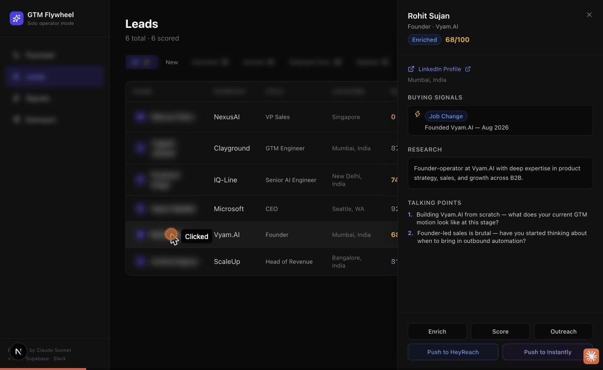
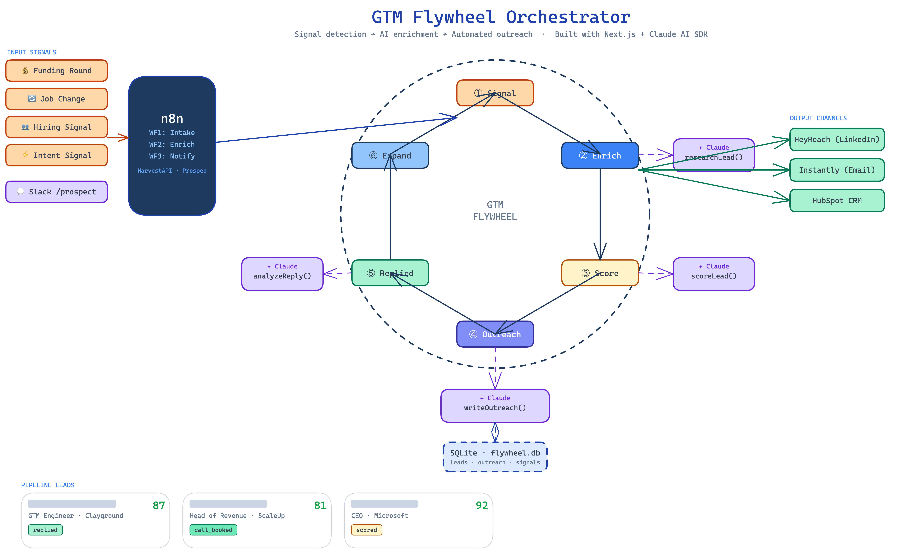
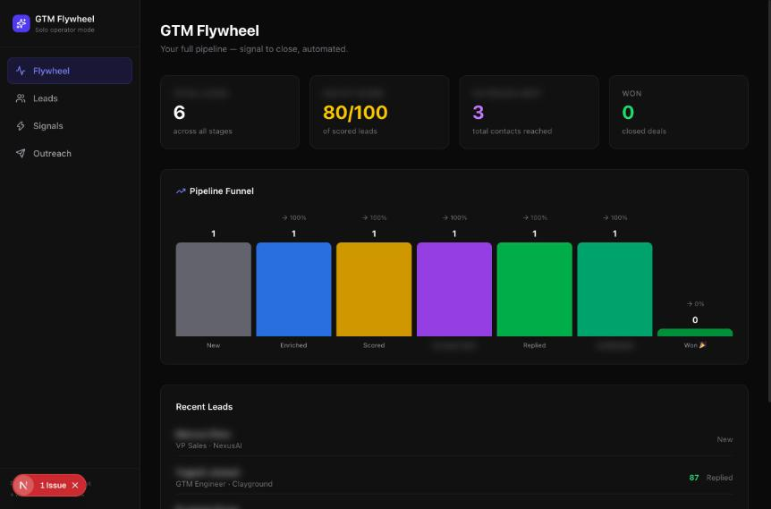
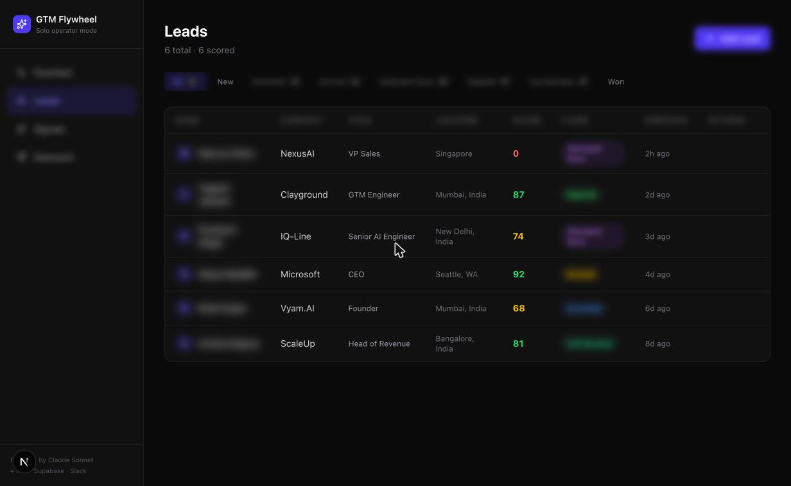
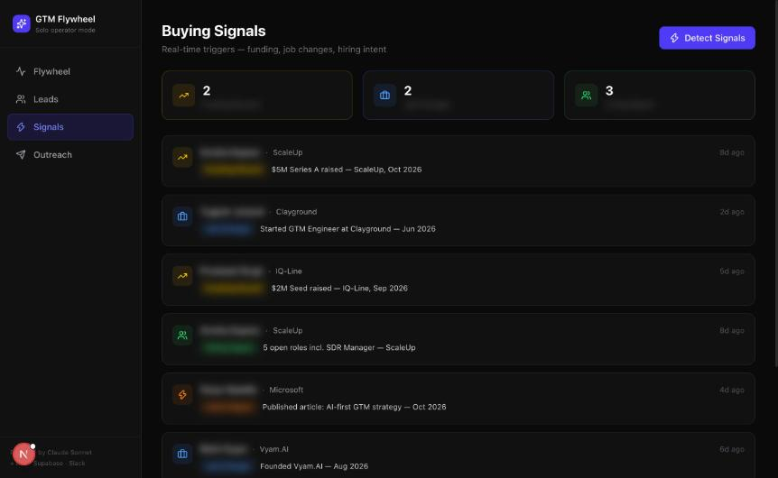
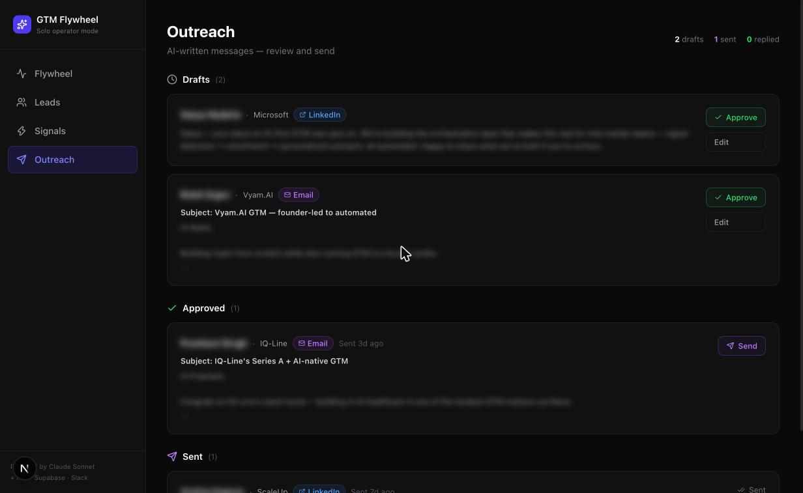
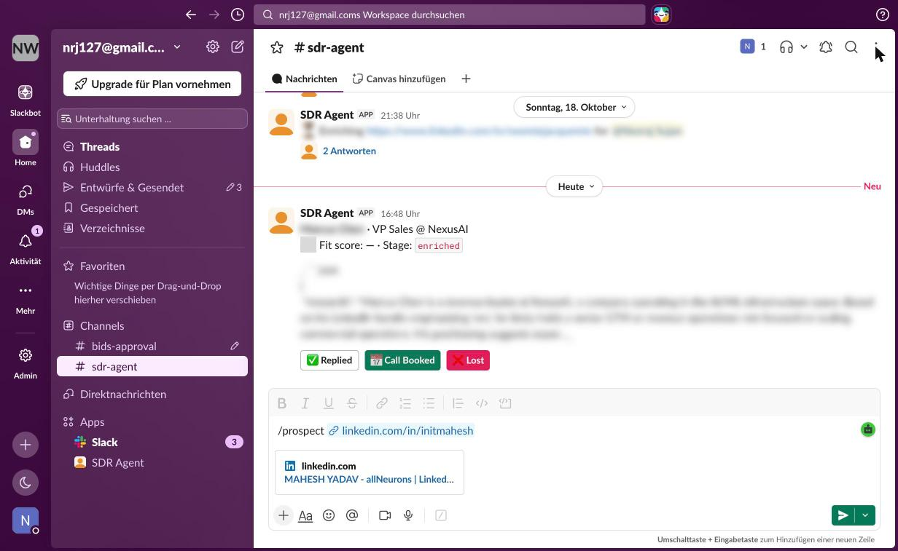
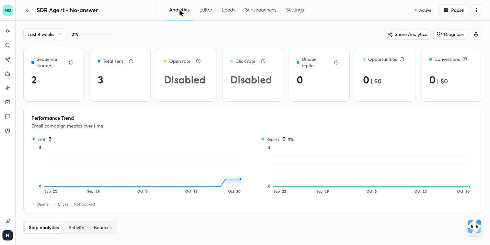
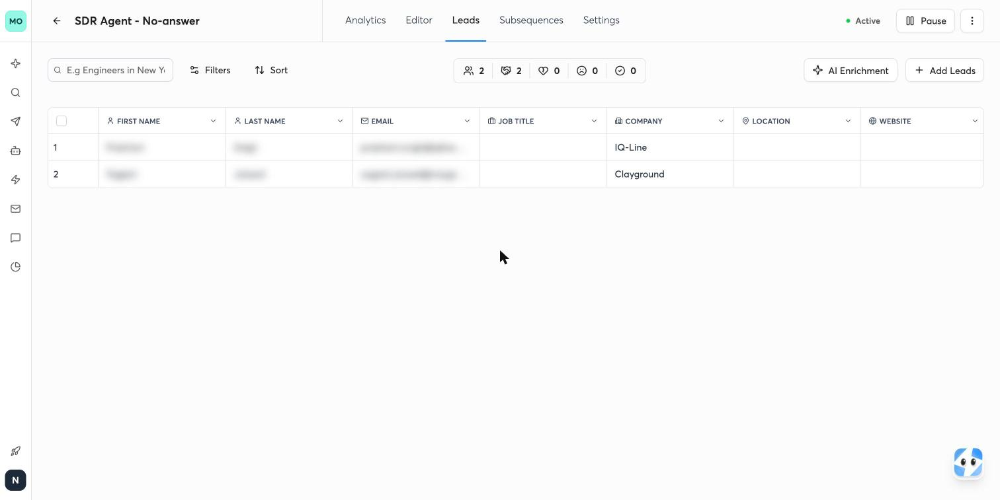
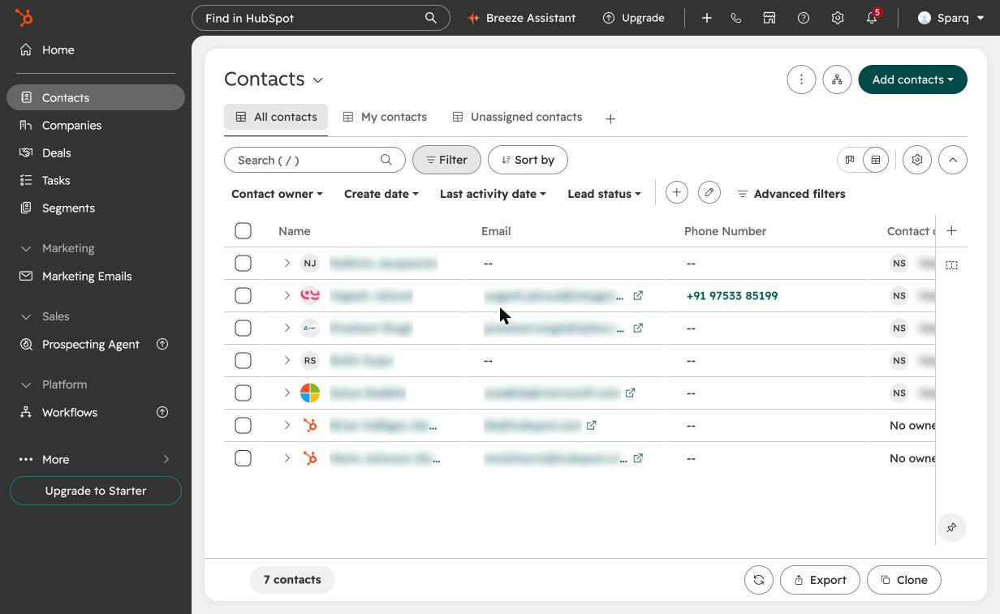

# GTM Flywheel Orchestrator

> One person running an entire company's GTM — signal to close, automated.

A full-stack AI-powered GTM platform that replaces the linear sales funnel with a self-reinforcing flywheel. Built to demonstrate how a single operator can orchestrate outbound prospecting, lead enrichment, ICP scoring, AI-written outreach, and CRM integration using modern AI infrastructure.

---

## Live Demo — Full Flow



*AI scores a lead 0–100, generates a personalized outreach message, pushes to Slack + HubSpot + HeyReach/Instantly — all in one click.*

---

## Architecture Diagram



---

## What It Does

| Stage | What happens |
|---|---|
| **Signal** | Detect buying intent — funding rounds, job changes, hiring signals, tech stack shifts |
| **Enrich** | Research the lead: role, company context, recent activity via AI (Claude Sonnet) |
| **Score** | Claude scores 0–100 fit against your ICP based on signals + research |
| **Outreach** | Claude writes hyper-personalized email or LinkedIn message |
| **Track** | Approve → Send → Track reply sentiment, suggest next action |
| **Expand** | Push to HeyReach (LinkedIn sequences) or Instantly (email sequences) |

---

## Screenshots

### Flywheel — Pipeline Funnel


### Leads — Full Pipeline Table


### Buying Signals — Real-time Trigger Feed


### Outreach — AI-Written Messages Queue


---

## Integration: Slack Lead Cards

When a lead is enriched, the bot posts a Block Kit card to Slack with one-click stage updates:



The **Replied / Call Booked / Lost** buttons trigger `POST /api/webhook/slack` and update the lead stage in real time.

---

## Integration: Live CRM + Sequences

The flywheel fires integrations automatically at each stage:

| Trigger | Integration | What fires |
|---|---|---|
| After `enrich` | Slack | Block Kit card with Replied / Call Booked / Lost buttons |
| After `score` | HubSpot | Contact upserted (create or update) with fit score + stage |
| After `write_outreach` (LinkedIn) | HeyReach | Lead enrolled in LinkedIn sequence |
| After `write_outreach` (email) | Instantly | Lead enrolled in email sequence |
| After `write_outreach` | HubSpot | Stage updated to `outreach_sent` |

All integrations are fire-and-forget — they don't block the UI response.

### Instantly — Email Sequence (live campaign)



*"SDR Agent - No-answer" campaign: Active · 3 emails sent · 2 leads enrolled from the flywheel*



*Leads from the flywheel auto-enrolled into the Instantly email sequence (names blurred)*

### HubSpot Contacts Synced



**HubSpot contacts synced from a live run (verified via API):**
```json
{ "firstname": "Satya", "lastname": "Nadella", "company": "Microsoft", "jobtitle": "Chairman and CEO" }
{ "firstname": "Rohit",  "lastname": "[redacted]",  "company": "Vyam.AI",    "jobtitle": "Founding Member"  }
{ "firstname": "Prashant", "lastname": "[redacted]", "company": "IQ-Line", "jobtitle": "Senior AI Engineer" }
```

---

## Architecture

```
┌─────────────────────────────────────────────────────────────────┐
│                        GTM Flywheel                             │
│                                                                 │
│  Next.js App Router                                             │
│  ┌──────────┐  ┌──────────┐  ┌──────────┐  ┌──────────┐       │
│  │Flywheel  │  │ Leads    │  │ Signals  │  │Outreach  │       │
│  │/dashboard│  │/dashboard│  │/dashboard│  │/dashboard│       │
│  └──────────┘  └──────────┘  └──────────┘  └──────────┘       │
│                                                                 │
│  API Routes                                                     │
│  ┌──────────────┐  ┌──────────────┐  ┌──────────────────┐     │
│  │/api/leads    │  │/api/flywheel │  │/api/webhook/slack│     │
│  │GET/POST/PATCH│  │POST (steps)  │  │URL verify + events│    │
│  └──────────────┘  └──────────────┘  └──────────────────┘     │
│                                                                 │
│  AI Agents (src/agents/flywheel-agent.ts)                       │
│  ┌────────────┐  ┌────────────┐  ┌──────────────┐             │
│  │scoreLead() │  │writeOut-   │  │researchLead()│             │
│  │0–100 fit   │  │reach()     │  │summary +     │             │
│  │score       │  │email/li    │  │talking pts   │             │
│  └────────────┘  └────────────┘  └──────────────┘             │
│                         │                                       │
│                    Claude Sonnet 4.5                             │
│                    (via AI SDK v7)                               │
│                                                                 │
│  Data Layer                                                     │
│  ┌──────────────────────────────────────────┐                  │
│  │  SQLite (better-sqlite3) · flywheel.db   │                  │
│  │  leads · outreach_messages · signals     │                  │
│  │  WAL mode · FK constraints · singleton   │                  │
│  └──────────────────────────────────────────┘                  │
│                                                                 │
│  Integrations (src/lib/integrations.ts)                         │
│  ┌──────────┐  ┌──────────┐  ┌──────────┐  ┌──────────┐       │
│  │  Slack   │  │HeyReach  │  │Instantly │  │HubSpot   │       │
│  │Block Kit │  │LinkedIn  │  │Email seq │  │CRM v3    │       │
│  └──────────┘  └──────────┘  └──────────┘  └──────────┘       │
└─────────────────────────────────────────────────────────────────┘
```

---

## Stack

| Layer | Technology |
|---|---|
| Framework | Next.js 16 App Router |
| AI | AI SDK v7 + `@ai-sdk/anthropic` (Claude Sonnet 4.5) |
| Database | SQLite via `better-sqlite3` (WAL mode, local file) |
| Styling | Tailwind CSS v4 |
| Icons | lucide-react |
| CRM | HubSpot CRM API v3 |
| Outreach channels | HeyReach (LinkedIn), Instantly (email) |
| Notifications | Slack Block Kit + webhook |

---

## Lead Stage Machine

```
new → enriched → scored → outreach_sent → replied → call_booked → won
                                                   ↘ nurture
                                                   ↘ lost
```

---

## Getting Started

### 1. Install dependencies

```bash
npm install
```

### 2. Environment variables

```bash
cp .env.example .env.local
```

Required:
```
ANTHROPIC_API_KEY=sk-ant-...

# Slack (optional — for lead card notifications + /prospect command)
SLACK_BOT_TOKEN=xoxb-...
SLACK_SIGNING_SECRET=...
SLACK_CHANNEL_ID=C...

# HubSpot (optional — for CRM sync)
HUBSPOT_ACCESS_TOKEN=pat-...
HUBSPOT_PORTAL_ID=...

# HeyReach (optional — for LinkedIn sequences)
HEYREACH_API_KEY=...
HEYREACH_CAMPAIGN_ID=...

# Instantly (optional — for email sequences)
INSTANTLY_API_KEY=...
INSTANTLY_CAMPAIGN_ID=...
```

### 3. Seed sample data

```bash
npm run seed
```

Seeds 6 leads across all pipeline stages + 3 outreach messages into `flywheel.db`.

### 4. Run locally

```bash
npm run dev
```

Open [http://localhost:3000](http://localhost:3000) — redirects to `/dashboard/flywheel`.

---

## API Reference

### `POST /api/flywheel`

Run a flywheel step for a lead.

```json
{
  "lead_id": "uuid",
  "step": "enrich" | "score" | "write_outreach"
}
```

### `GET /api/flywheel`

Returns funnel stats: count per stage, avg fit score, conversion rates.

### `GET /api/leads`

```
?stage=enriched
?icp_id=uuid
```

### `POST /api/leads`

```json
{ "linkedin_url": "https://linkedin.com/in/..." }
```

### `PATCH /api/leads`

```json
{ "id": "uuid", "stage": "call_booked", "fit_score": 87 }
```

### `POST /api/webhook/slack`

Handles Slack events:
- URL verification challenge
- `block_actions` — button clicks update lead stage
- `message` — `/prospect <url>` inserts new lead and triggers enrichment

---

## Project Structure

```
src/
  agents/          # AI agent functions (score, write, research)
  app/
    api/           # Route handlers
    dashboard/     # Pages: flywheel, leads, signals, outreach
  components/      # LeadDetailPanel, StageBadge, Badge, RelativeTime
  lib/             # SQLite adapter (db.ts), integrations.ts, utils
  types/           # Shared TypeScript types
scripts/
  seed.ts          # Seeds flywheel.db with sample leads + outreach
docs/
  screenshots/     # UI screenshots + GIFs
gtm-flywheel-architecture.png   # Architecture diagram
```
